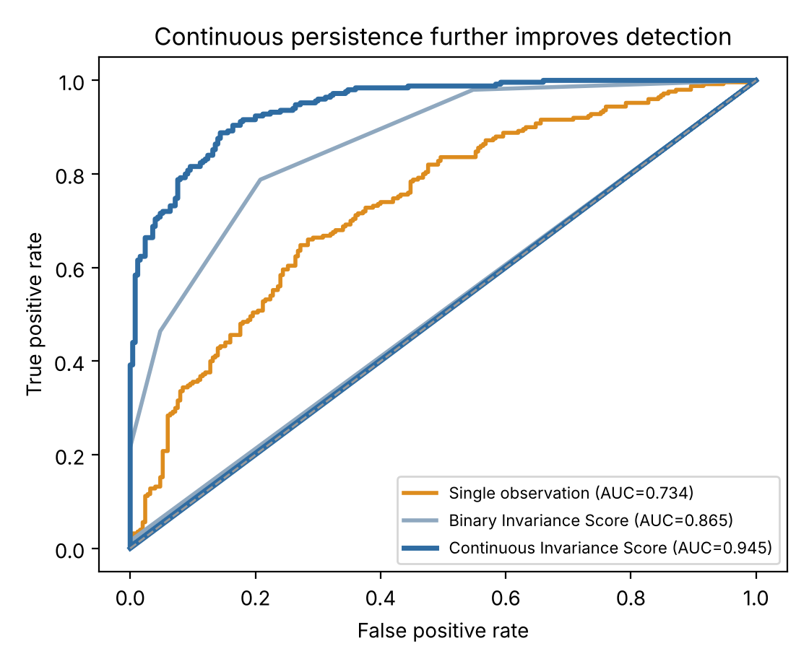
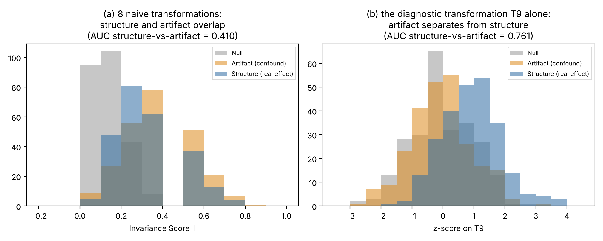

# The Diagnosticity Condition

[](https://doi.org/10.5281/zenodo.23440654)

Simulation and analytic-validation code for:

> Avramescu, A. N. *The Diagnosticity Condition: A Dilution Theorem for Persistence-Based Evidence.* Manuscript under review, *Foundations of Science*.
>
> Code: Avramescu, A. N. (2026). *diagnosticity-condition* [Software]. Zenodo. https://doi.org/10.5281/zenodo.23440654

No real-world data is used anywhere. Every number and figure in the paper is generated by the seeded scripts below and can be regenerated exactly.




## What is here

| File | Produces | Paper section |
|---|---|---|
| `simulate_continuous.py` | Fig. 1 (ROC curves), `results_continuous.json`, `sweep_continuous.json` | Section 4: baseline demonstration (persistence versus pure noise) |
| `diagnosticity.py` | Fig. 2, Table 2 (seed-42 column and exact column), `diagnosticity_results.json` | Section 5: worked example and the exact Poisson-binomial dilution theorem (Section 5.5) |
| `replicate_seeds.py` | `replication_results.json` (2,000-seed replication) | Table 2 (replication column), Sections 4, 5.2, 5.5 |

## Reproducing the results

```bash
pip install -r requirements.txt
python simulate_continuous.py
python diagnosticity.py
python replicate_seeds.py
```

All three scripts run in under a minute on an ordinary laptop. Figures are written as 600 dpi PNG and as vector PDF.

## Key results

Dilution factor for the worked example: gamma = 0.288 (the naive 1/sqrt(9) rule would give 0.333).

Structure-versus-Artifact AUC (Table 2 of the paper):

| Detector | Seed 42 | Mean (SD), 2,000 seeds | Exact |
|---|---|---|---|
| Single best specification | 0.447 | 0.500 (0.026) | 0.500 |
| Flat Invariance Score, 8 naive transformations | 0.410 | 0.500 (0.026) | 0.500 |
| Flat Invariance Score, 8 naive + 1 diagnostic, unweighted | 0.460 | 0.550 (0.025) | 0.550 |
| Diagnostic transformation T9 alone | 0.761 | 0.738 (0.022) | 0.738 |
| Logistic combination of I8 and T9 (in-sample) | 0.775 | 0.739 (0.022) | not derived |

Baseline demonstration (structure versus null, Section 4), seed 42: single observation 0.734, binary Invariance Score 0.865, continuous Invariance Score 0.945 (2,000-seed means 0.761, 0.887, 0.958).

## Notes on transparency

- **Seed 42 is a low draw.** The paper reports the single seed-42 draw unaltered. For the first two rows of the table it lies about 3.5 standard deviations below the exact value (lowest 0.1% of replications). `replicate_seeds.py` shows this; the exact values and replication means carry the argument.
- **Tie handling.** An earlier implementation of `auc_rank()` used ordinal ranks, which biases AUC on the heavily tied Invariance Score. All scripts now use mid-ranks (the Mann-Whitney convention).
- **In-sample combination.** The logistic combination is fitted and scored on the same data and is optimistic in any single draw; its replication mean equals that of T9 alone.

## Requirements

Python 3.9+, numpy, scipy, matplotlib, scikit-learn (see `requirements.txt`).

## License

MIT (see `LICENSE`).

## Citation

See `CITATION.cff`, or use the citation above.
